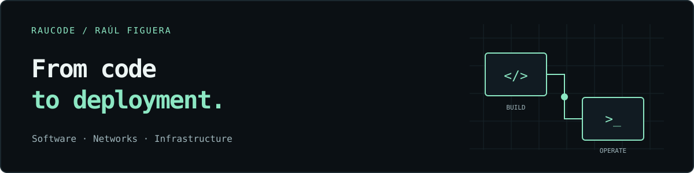
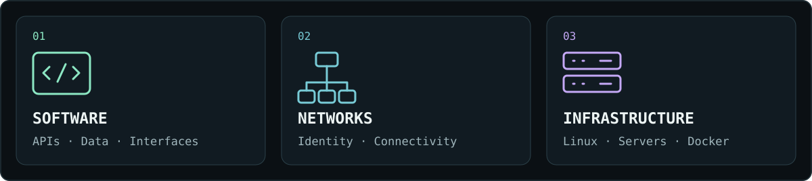
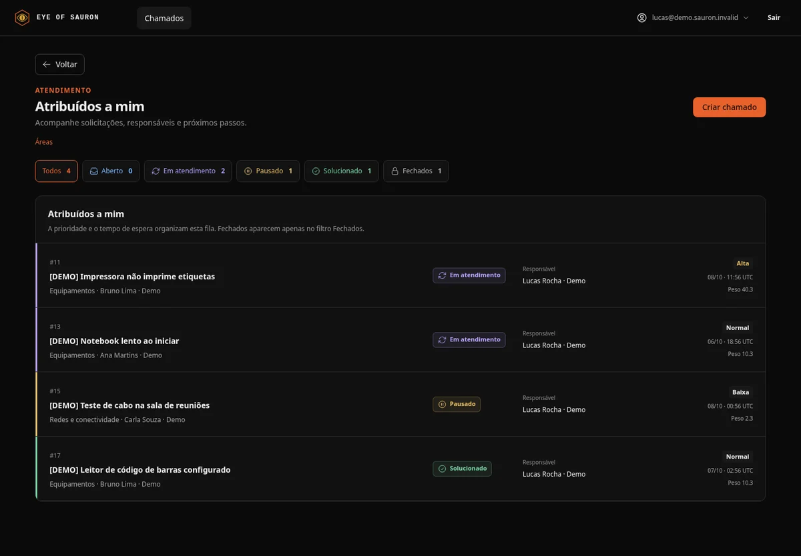
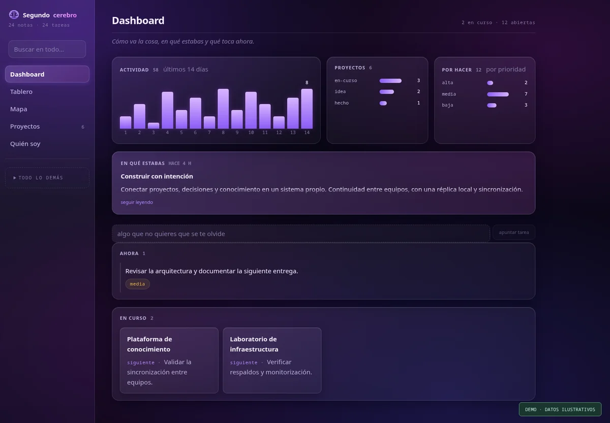
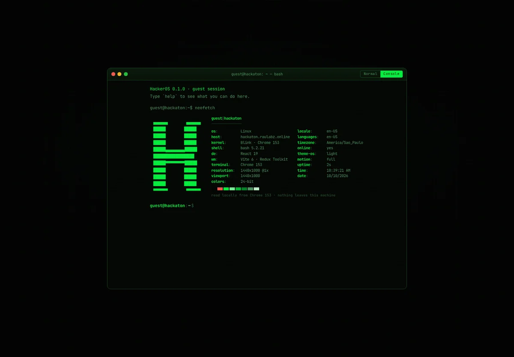
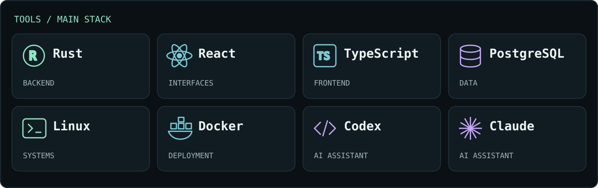
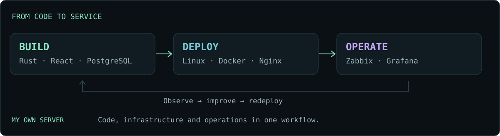

# Raúl Figuera

**Software development · Networks · Infrastructure**

  
  
  

I'm a developer based in Brazil with a backend focus. Rust is my main tool; I also work on frontend development, networks and infrastructure. I like understanding the whole system: how it's built, how it connects and how it keeps running.

I configured and maintain my own server, where I host applications and services. I build IT operations tools and games, and founded [RDX Entertainment](https://rdxentertainment.raulabz.online/), my independent game studio.

## What I work on

- **Backend and architecture:** APIs, data models, authentication, permissions and integrations.
- **Products and interfaces:** turning system logic into clear, usable experiences.
- **Networks and infrastructure:** Linux servers, virtualization, containers, identity and monitoring.
- **Tools I build:** software to solve operational problems and preserve context across projects and devices.

## Featured projects

  
  
  

- **[Sauron](https://www.raulabz.online/#projects)** · IT operations with inventory, Windows agents, service requests and Active Directory integration. Deployed enterprise beta with restricted access. The screenshot shows the demo.
- **[Second Brain](https://www.raulabz.online/#projects)** · A self-hosted platform for knowledge, projects and decisions. Rust API, PostgreSQL, agents and local replicas with synchronization to keep working offline.
- **[Hackaton](https://hackaton.raulabz.online/)** · A fictional hacking game built with Rust and React, featuring software, hardware, an economy and progression. Hosted on my server and under active development.

[More projects, screenshots and details →](https://www.raulabz.online/#projects)

## Stack

| Area | Tools |
| --- | --- |
| Backend and data | **Rust**, Actix Web, SQLx, PostgreSQL, Elixir, Phoenix LiveView |
| Frontend | React, TypeScript, JavaScript, Redux Toolkit, Tailwind CSS, Vite |
| Systems and deployment | Linux, Proxmox, Docker, Nginx, Cloudflare, Bash |
| Networks and IT operations | Active Directory, GLPI, Zabbix, Grafana, DNS, SSH |
| Automation and planning | Python, Google Apps Script, OpenAPI, draw.io, Markdown |
| AI-assisted development | **Codex · Claude** |

## From development to operations

My own server is part of my daily work: I host services, prepare deployments and monitor them with **Zabbix and Grafana**. This connects my programming experience with real networking and infrastructure challenges.

I use **Codex and Claude** as assistants to explore solutions, implement features, review code and document my work. Second Brain provides project context and helps preserve continuity across tools and devices.

## Public code

Some of my work lives in private repositories. You can explore these public components:

- [**Rust Auth System**](https://github.com/raucode/rust-auth-system): authentication and permissions for Rust services.
- [**Rust Subscription & Plan Component**](https://github.com/raucode/Rust-Suscription-and-plan-Componet): a backend component for plans, subscriptions and payments.
- [**Portfolio**](https://github.com/raucode/Portfolio): my React portfolio with three languages, projects and a printable resume.

---

**Never stop learning.**
